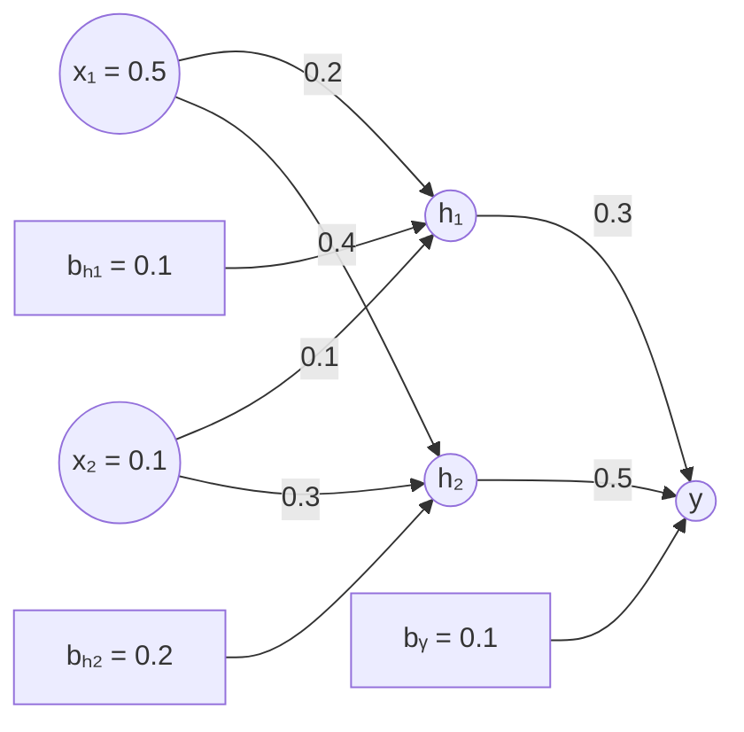

# 习题 12–14

## 12. 主成分分析（PCA）

请对以下数据进行主成分分析，可使用 Python 等编程语言实现。

| 样本 | 特征 1 | 特征 2 | 特征 3 | 特征 4 |
|:---:|---:|---:|---:|---:|
| 1 | 2.5 | 2.4 | 3.5 | 3.0 |
| 2 | 0.5 | 0.7 | 1.2 | 1.1 |
| 3 | 2.2 | 2.9 | 3.1 | 3.2 |
| 4 | 1.9 | 2.2 | 2.5 | 2.8 |

## 13. 反向传播算法

请使用反向传播算法计算下图神经网络各权重的梯度，可使用 Python 等编程语言实现。

**网络结构和参数：**

- 输入：$x_1 = 0.5$，$x_2 = 0.1$。
- 输入层到隐藏层的权重：$w_{11} = 0.2$（$x_1 \to h_1$），$w_{12} = 0.4$（$x_1 \to h_2$），$w_{21} = 0.1$（$x_2 \to h_1$），$w_{22} = 0.3$（$x_2 \to h_2$）。
- 隐藏层偏置：$b_{h_1} = 0.1$，$b_{h_2} = 0.2$。
- 隐藏层到输出层的权重：$v_1 = 0.3$（$h_1 \to y$），$v_2 = 0.5$（$h_2 \to y$）。
- 输出层偏置：$b_y = 0.1$。
- 目标标签：$t = 0.6$。
- 损失函数：均方误差（MSE）。

**图 13：神经网络结构示意图**

> 注：原题图未注明激活函数。上图保留了题图给出的输入、权重、偏置及输出关系。

## 14. 基于 CNN 的 MIMO 信道估计

考虑上行 MIMO 信道估计，用户为**单天线**，基站为 **64 天线的半波长间距均匀线性阵列**。默认信道包含 **3 条随机角度的多径**，复增益与噪声均服从高斯分布，接收信噪比为 **10 dB**。

请自行产生仿真数据，并设计、训练一种基于 **CNN** 的智能信道估计算法，对比其与 **LS（最小二乘）信道估计** 的性能。
