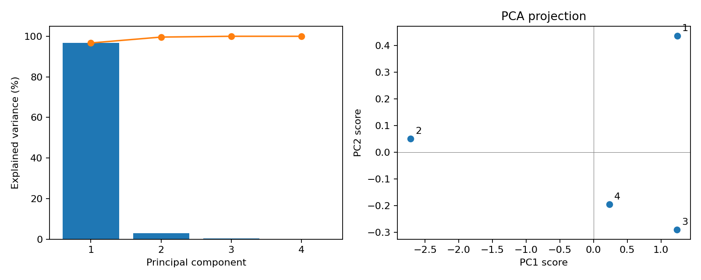

# 第三章 第12题：主成分分析（PCA）

## 解题约定

行表示样本，列表示特征。本答案对原数据做中心化，使用样本协方差矩阵，不对各特征额外标准化。题目未指定保留维数，给出全部主成分，并以保留两维展示降维结果；同时计算累计解释方差达到 95% 所需的维数。

## 计算过程与参考结果

原始矩阵与均值为：

```text
X = [[2.5, 2.4, 3.5, 3.0],
     [0.5, 0.7, 1.2, 1.1],
     [2.2, 2.9, 3.1, 3.2],
     [1.9, 2.2, 2.5, 2.8]]

μ = [1.775, 2.050, 2.575, 2.525]
```

令 $X_c=X-\mu$，其中均值逐行广播。样本协方差为 $C=X_c^T X_c/(n-1)$，本题 $n=4$：

```text
C = [[0.782500000, 0.785000000, 0.879166667, 0.827500000],
     [0.785000000, 0.896666667, 0.871666667, 0.901666667],
     [0.879166667, 0.871666667, 1.009166667, 0.910833333],
     [0.827500000, 0.901666667, 0.910833333, 0.929166667]]
```

对 $C$ 做对称特征分解，并将特征值从大到小排列。解释方差比为 $r_i=\lambda_i/\sum_j\lambda_j$。

| 主成分 | 特征值 | 解释方差比 | 累计解释方差比 |
| --- | ---: | ---: | ---: |
| PC1 | 3.498509808 | 96.710706% | 96.710706% |
| PC2 | 0.104835988 | 2.898023% | 99.608730% |
| PC3 | 0.014154203 | 0.391270% | 100% |
| PC4 | 约 0 | 约 0% | 100% |

四个样本中心化后秩为 3，因此第四个特征值为 0（浮点运算下可能有极小残差）。

前两个主成分方向组成 $P_2$，每列为一个单位特征向量：

```text
P₂ = [[0.468366469,  0.332155735],
      [0.494169740, -0.606225564],
      [0.525225230,  0.625622683],
      [0.510458203, -0.361606682]]
```

投影 $Z=X_cP_2$ 得到：

| 样本 | PC1 得分 | PC2 得分 |
| --- | ---: | ---: |
| 1 | 1.240826083 | 0.435571769 |
| 2 | −2.713884027 | 0.049964281 |
| 3 | 1.239402561 | −0.289758143 |
| 4 | 0.233655383 | −0.195777906 |

特征向量乘以 −1 仍是正确答案，相应投影列也会变号。程序统一令每个特征向量中绝对值最大的元素为正。

两维结果保留约 **99.6087%** 的总方差。使用 $\hat X=ZP_2^T+\mu$ 重构，16 个数据元素的均方误差为 **0.002653913098**。若仅要求累计解释方差至少 95%，保留 **1 个主成分** 即可。



## 运行说明

在本题目录运行：

```bash
conda activate pt2
python main.py
```

或在上一级目录运行 `conda run --no-capture-output -n pt2 python 第三章-第12题/main.py`。

依赖 NumPy 和 Matplotlib，无须下载数据。`main.py` 中 `pca()` 执行计算，`verify()` 检查结果，`save_plot()` 画图。

输出文件：

- `results/results.json`：均值、协方差、全部特征值和方向、解释方差比、两维投影和重构结果。
- `results/pca.png`：解释方差图与二维投影图。

## 实际验证

已用 `pt2` 的 Python 3.9.18 / NumPy 1.23.2 执行，所有断言通过：特征值与中心化矩阵的 SVD 一致；主成分正交；满足特征方程；保留全部维数时可重构原数据；丢弃主成分的特征值之和与实际重构误差一致。
