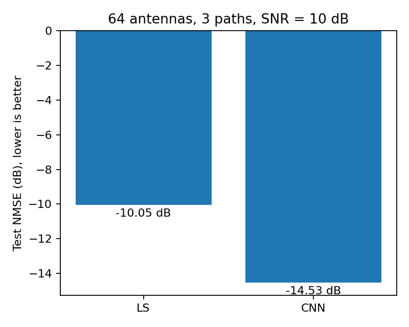
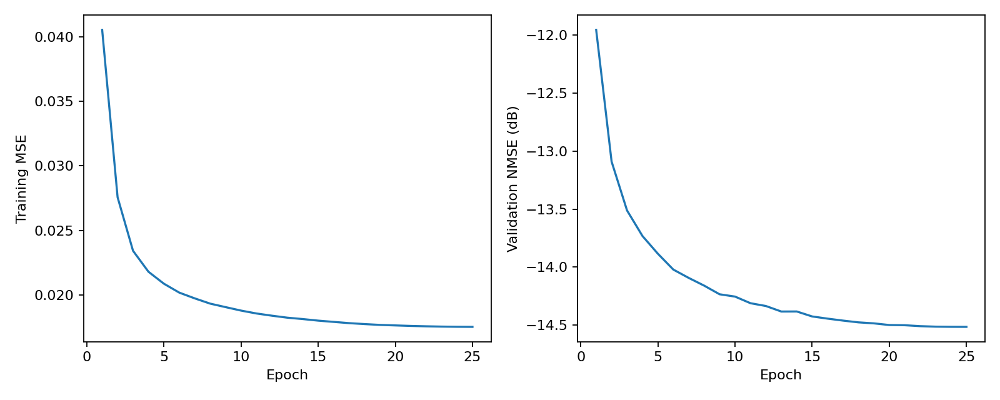

# 第三章 第14题：基于 CNN 的 MIMO 信道估计

## 信道和观测模型

单天线用户到基站 64 天线的链路为 $64\times1$ 复信道向量。采用窄带块衰落模型，每个样本独立生成一个信道。半波长间距均匀线性阵列的响应为：

$$
\mathbf a(\theta)=[1,e^{j\pi\sin\theta},\ldots,e^{j63\pi\sin\theta}]^T.
$$

默认三条路径：

$$
\mathbf h=\frac1{\sqrt{3}}\sum_{\ell=1}^{3}\alpha_\ell\mathbf a(\theta_\ell),\quad
\alpha_\ell\sim\mathcal{CN}(0,1),\quad
\theta_\ell\sim\mathcal U[-\pi/2,\pi/2].
$$

各路径的角度和复增益独立，$\mathbb E|h_m|^2=1$。由于题目未指定导频，选择已知单位导频 $x=1$，接收信号为：

$$
\mathbf y=\mathbf h x+\mathbf n=\mathbf h+\mathbf n,\qquad
\mathbf n\sim\mathcal{CN}(\mathbf0,0.1\mathbf I_{64}).
$$

因此接收 SNR 为 $10\log_{10}(1/0.1)=10$ dB。复噪声实部和虚部的方差分别为 0.05。这里按总体平均信号功率定义 SNR，有限样本的实测 SNR 会略有波动；不按单个真实信道的能量缩放输入或噪声。

## LS 与 CNN

单位导频下，最小二乘解为 $\hat{\mathbf h}_{LS}=\mathbf y/x=\mathbf y$。理论上总体 NMSE 约为 $0.1$，即 −10 dB。

CNN 将实部、虚部堆叠为两个通道，输入形状为 `(batch, 2, 64)`，沿天线维度做一维卷积。输入仅包含接收信号，真实信道只作为监督标签。网络学习噪声修正量，输出：

$$
\hat{\mathbf h}_{CNN}=\mathbf y-f_\phi(\mathbf y).
$$

网络结构如下，所有卷积步长为 1，并使用保持长度不变的零填充：

| 层 | 输入通道 → 输出通道 | 卷积核 | 激活 |
| --- | --- | --- | --- |
| Conv1d | 2 → 64 | 9 | ReLU |
| Conv1d | 64 → 64 | 5 | ReLU |
| Conv1d | 64 → 64 | 5 | ReLU |
| Conv1d | 64 → 2 | 9 | 无 |

最后一层初始化为 0，初始估计等于 LS；之后通过训练学习利用阵列上的空间相关性去噪。输出层为线性层，允许实部、虚部为任意正负值。训练损失为复信道误差在两个实数通道上的 MSE，等于复误差模平方均值的一半，该常数不改变最优解。

默认训练配置：

| 项目 | 设置 |
| --- | --- |
| 训练 / 验证 / 测试样本数 | 24,000 / 3,000 / 6,000 |
| 数据随机种子 | 42 / 43 / 44 |
| 训练轮数 / batch size | 25 / 256 |
| 优化器 | Adam，初始学习率 0.001 |
| 学习率调度 | 余弦衰减 |
| 模型选择 | 验证集 NMSE 最低的轮次 |

三个数据集独立生成且不复用样本。测试集在训练与模型选择结束后生成，仅用于最终评价；训练过程中只读取训练集和验证集。

## 性能指标和实际结果

CNN 与 LS 使用完全相同的测试信道与噪声。对所有测试样本累加误差能量和真实信道能量：

$$
\mathrm{NMSE}=\frac{\sum_{s=1}^{N}\|\hat{\mathbf h}_s-\mathbf h_s\|_2^2}
{\sum_{s=1}^{N}\|\mathbf h_s\|_2^2},\qquad
\mathrm{NMSE}_{dB}=10\log_{10}(\mathrm{NMSE}).
$$

数值越低越好。程序先汇总能量再换算 dB，不对各样本的 dB 值取平均。

已在 `pt2` 的 Python 3.9.18 / PyTorch 2.1.0 / NVIDIA RTX 5000 Ada Generation 上按默认参数完整训练 25 轮，最优轮次为第 25 轮：

| 方法 | 独立测试集 NMSE（dB） |
| --- | ---: |
| LS | −10.0467 |
| CNN | **−14.5303** |

CNN 比 LS 改善约 **4.4837 dB**，误差能量降低约 **64.38%**。该结论对应题设的三径、10 dB 和上述角度分布；改变信道分布或 SNR 后应重新评估。固定了随机种子和 cuDNN 确定性设置，不同硬件或库版本下末位数值仍可能有差异。





## 文件结构和运行说明

```text
data.py    # 阵列响应、复信道、噪声及实数张量转换
model.py   # 四层残差 CNN
main.py    # 训练、验证集选模、测试集比较、模型保存和绘图
verify.py  # 信道统计、LS 理论值及网络约定检查
README.md  # 推导、运行方法和实验结论
results/   # 已运行得到的结果
```

在本题目录运行完整实验：

```bash
conda activate pt2
python verify.py
python main.py
```

在上一级目录也可运行：

```bash
conda run --no-capture-output -n pt2 python 第三章-第14题/verify.py
conda run --no-capture-output -n pt2 python 第三章-第14题/main.py
```

依赖 NumPy、PyTorch、Matplotlib。无需外部数据。默认自动使用 GPU，没有 GPU 时自动使用 CPU；可用 `python main.py --device cpu` 强制 CPU。

可调整训练轮数、数据量和输出位置，例如：

```bash
python main.py --epochs 30 --train-samples 30000 --output results_30epochs
python main.py --help
```

为了复现上表，直接使用默认参数。默认会更新本题目录的 `results/`，可通过 `--output` 保留其他实验结果。

默认输出包括：

- `results/results.json`：配置、解释器与库版本、逐轮训练/验证指标、最佳轮次和最终测试指标。
- `results/model.pt`：验证集最优模型的 CPU 格式权重。
- `results/training.png`：训练 MSE 与验证 NMSE 曲线。
- `results/comparison.png`：CNN 和 LS 的测试 NMSE 对比。
- `results/example.png`、`results/example.npz`：第一个测试样本的真实信道、LS 和 CNN 估计，仅用于展示，不据此挑选样本。

在本题目录加载已训练权重进行推断：

```python
import torch
from data import simulate, as_real_tensor
from model import ChannelCNN

model = ChannelCNN()
model.load_state_dict(torch.load("results/model.pt", map_location="cpu", weights_only=True))
model.eval()
_, received = simulate(1, snr_db=10.0, seed=2027)
with torch.no_grad():
    estimate = model(as_real_tensor(received))  # (1, 2, 64)
channel_estimate = estimate[0, 0].numpy() + 1j * estimate[0, 1].numpy()
```

## 实际验证

`verify.py` 已通过以下检查：已知角度的阵列相位差、随机数据可复现、单位平均信道功率、正确的复噪声方差、LS 理论 NMSE、实虚通道转换、初始 CNN 等于 LS，以及网络参数梯度有限。用 10,000 个独立样本核验得到信道功率 **0.996451**、噪声功率 **0.100039**、LS NMSE **−9.9829 dB**，与理论值吻合。

完整实验额外检查了损失和指标有限、独立测试集 CNN 优于 LS、保存模型重新加载后输出一致。上述检查都由代码中的断言执行。
