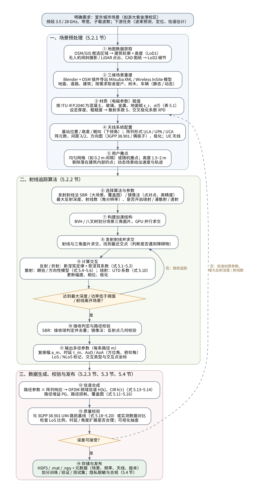
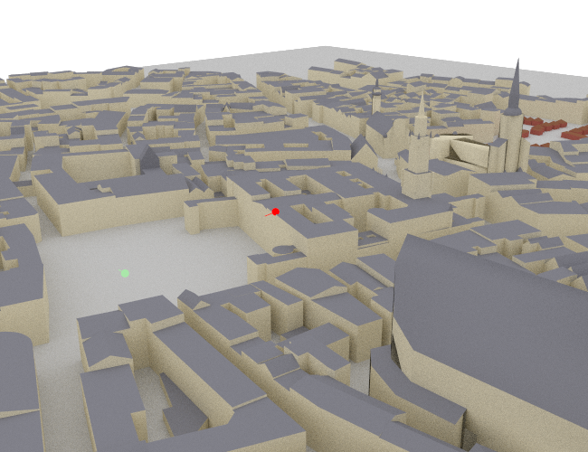
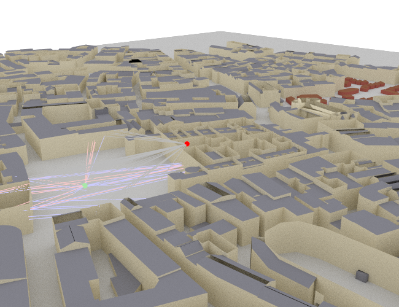
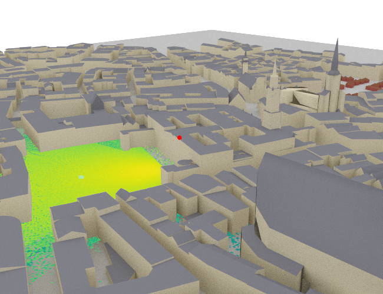
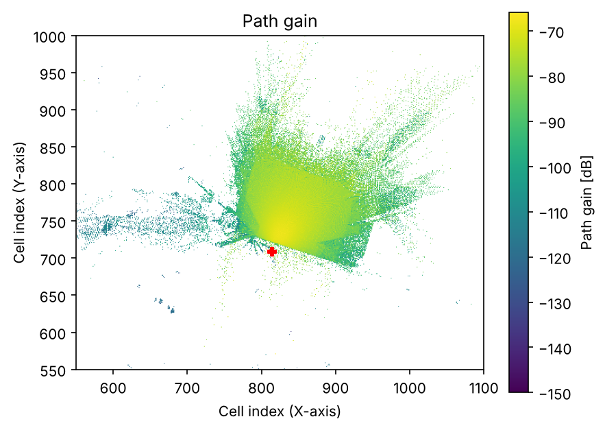
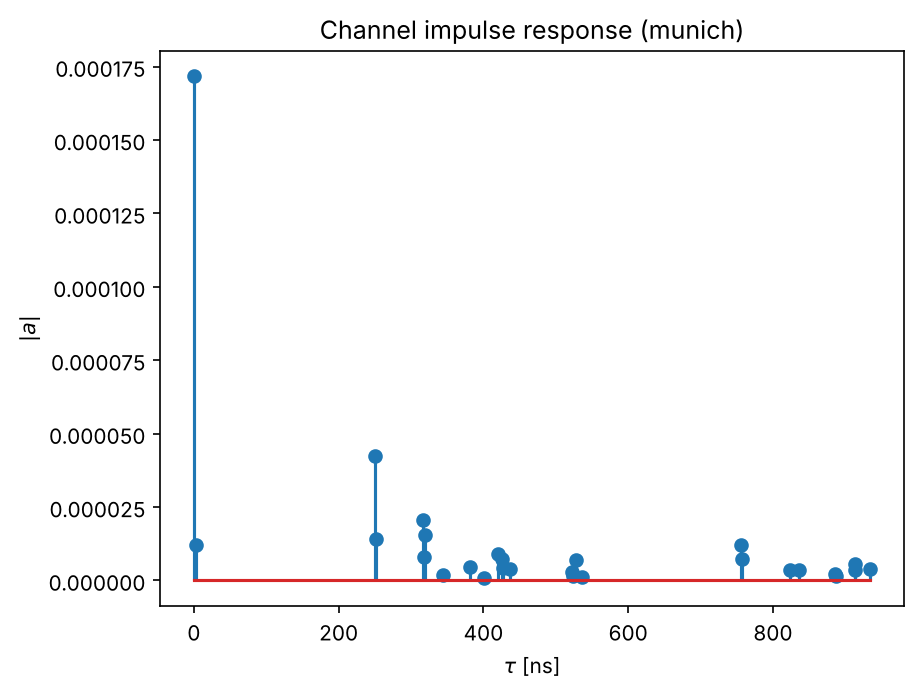

# 第 5 章　智能通信数据集 —— 习题参考答案

---

## 第 1 题　数据集生成逻辑与流程图（室外场景）

**题目**：如果需要生成一个数据集，需要采用什么样的逻辑？请按"场景预处理"和"射线追踪算法"两方面，选择室外或室内场景，画出完整的流程图。

### 1.1 总体逻辑

本章 5.2 节把数据集生成分成两大部分：**场景预处理**和**射线追踪算法**。再加上 5.2.3 节、5.3 节的"多径参数获取、信道合成与校验"，一个完整的数据集生成过程可以概括为三步：

1. **先把世界搭出来**（场景预处理）：地图 → 三维模型 → 材质 → 天线 → 用户撒点；
2. **再让电波在里面跑**（射线追踪）：发射射线 → 求交 → 反射/折射/散射/绕射 → 终止判断 → 接收判定，得到每条路径的参数；
3. **最后把路径变成可用的数据**：信道合成（CIR / OFDM 频域信道 / 路径损耗 / 覆盖图）→ 质量校验 → 存储与发布。

这里以**室外城市场景**为例（例如按图 5.9 用 OSM 框选浙江大学紫金港校区），流程图如下：



> 矢量版：`figs_ch5/q1_flow.svg`

### 1.2 流程中的关键细节（答题要点）

| 阶段 | 步骤 | 需要注意的细节 |
|---|---|---|
| 场景预处理 | ① 地图获取 | OSM/GIS 只能得到 LoD1 的"方块楼"（轮廓 + 高度）。窗户等 LoD2 细节要靠无人机倾斜摄影、LiDAR 点云或 CAD 图纸补充 |
| | ② 三维重建 | 常用 Blender + OSM 插件导出 Mitsuba XML（Sionna）或导入 Wireless InSite。按应用需求取舍窗户、树木、车辆。动态场景要给出车辆的速度和轨迹（如 WithRay） |
| | ③ 材质赋值 | 按 ITU-R P.2040 给每类表面赋相对介电常数 ε_r 和电导率 σ(f)（表 5.1）。σ 随频率变化，一定要和仿真载频对应。另外设置厚度、散射系数 S、交叉极化系数 XPD |
| | ④ 天线配置 | 基站位置、高度、下倾角；ULA/UPA/UCA 阵列形式（图 5.22）、阵元数、间距（通常 λ/2）、方向图（3GPP 38.901 / 偶极子）、极化 |
| | ⑤ 用户撒点 | 均匀网格（DeepMIMO O1 为 0.2 m 间隔）或随机撒点（WAIR-D）。用户高度一般固定为 1.5~2 m。要剔除落在建筑内部的点 |
| 射线追踪 | ⑥ 算法选择 | 发射射线法（SBR）适合大场景和覆盖图，镜像法适合点对点、高精度但反射次数多时复杂度高（5.2.2 节）。最大反射深度、射线数（角分辨率）、是否开启绕射/漫散射/透射，决定了精度与计算量之间的折中 |
| | ⑦ 加速 | 用 BVH / 八叉树组织场景面片，配合 GPU 并行求交（5.5.1 节第 3 点） |
| | ⑧~⑩ 追踪循环 | 求最近交点 → 按交互类型计算系数（式 5.1~5.10）→ 判断是否终止 → SBR 用接收球判定并去重，镜像法做反射点几何校验 |
| | ⑪ 输出 | 每条路径的复振幅 a_m、时延 τ_m、AoD/AoA、LoS 标记、交互点 |
| 数据生成 | ⑫ 信道合成 | 路径参数 × 阵列响应 → H[k]、h(τ)、PG（式 5.11~5.16） |
| | ⑬ 校验 | 与 3GPP 38.901 UMi 路损基线（式 5.18~5.20）或实测数据对比。不合格就回到材质 / 反射深度重新校准（流程图中的虚线回路） |
| | ⑭ 发布 | 保存数据和元数据（场景、频率、天线、软件版本），划分训练 / 验证 / 测试集，做隐私脱敏（5.4 节） |

> **可参考 Sionna 官方代码**：场景加载与编辑见 Sionna RT "Tutorial on Loading and Editing of Scenes"（<https://nvlabs.github.io/sionna/rt/tutorials/Scene-Edit.html>），覆盖图生成见 "Tutorial on Radio Maps"（<https://nvlabs.github.io/sionna/rt/tutorials/Radio-Maps.html>）。

---

## 第 2 题　射线追踪算法在无线通信系统仿真中的作用和优势

### 作用

1. **确定性信道建模的核心引擎**：给定三维场景、材质和天线配置后，射线追踪计算出每条传播路径的幅度、相位、时延、到达/离开角和极化，从而还原 CSI（5.1 节、5.2.3 节）。
2. **为无线 AI 大规模生成带标签数据**：DeepMIMO、WAIR-D、Sionna 等数据集都靠它产生信道、位置、LoS 标签等，用于波束预测、信道估计、定位等模型的训练和测试。
3. **网络规划与覆盖预测**：生成路径损耗图 / 覆盖图，用于站址选择、天线下倾优化、盲区检测。
4. **数字孪生的物理层**：在虚拟城市里复现真实电磁环境，评估新算法、新部署方案，不必上网实测。

### 优势

1. **精确的站点特定建模**：直接基于真实几何和材质，能描述反射、折射、绕射、散射等多径效应，比统计模型更贴近具体场景。
2. **多径信息完整**：一次仿真同时得到角度域、时延域、功率域和极化信息，适合大规模 MIMO、波束赋形研究。
3. **适用频段宽**：在毫米波、太赫兹等高频段，几何光学近似更准确，射线追踪尤其适用。
4. **场景适应性强**：室内、城市、郊区、厂区都可以建模，适应不同的传播场景。
5. **可控、可重复、成本低**：基站位置、天线阵列、材质、用户分布都能自由修改，同一配置可以完全复现，代替大量昂贵的实测。
6. **空间一致性好**：相邻用户的信道随位置连续变化，适合移动性、轨迹预测、定位类研究。
7. **可加速、可微分**：现代工具（如 Sionna RT）基于 GPU 并行，并支持对材质、天线方向等参数求梯度，可用实测数据反向校准场景。

> 局限（了解即可）：精度依赖场景模型和材质参数的准确性；反射次数和射线数增加时计算量会迅速上升；树木、窗户、移动物体等细节建模仍不充分（5.5.1 节）。

---

## 第 3 题　用 DeepMIMO 生成 O1 场景的数据集

### 3.1 操作流程（deepmimo.net）

1. 打开 <https://www.deepmimo.net>，进入 **Scenarios**，找到 **O1** 场景，选择频段版本（`O1_3p5` / `O1_28` / `O1_60`，以及遮挡版本 `O1_3p5B` / `O1_28B`）。
2. 安装生成器：`pip install deepmimo`（当前为 v4 Python 包，也有 MATLAB 旧版）。
3. 下载场景的射线追踪数据（网页手动下载，或在代码中用 `dm.download()`）。
4. **设置参数**：激活的基站（active BS）、用户行范围（user rows）/ 用户子采样、基站与用户的天线阵列（shape、spacing、rotation、方向图）、OFDM 参数（子载波数、选取的子载波、带宽）、路径数。
5. 运行生成，得到每个用户的信道矩阵 H、位置、LoS 标记、路径参数等。
6. 挑选几个用户画信道图、打印信道矩阵，并画出基站和用户的位置分布。

### 3.2 O1 场景特点（答题要点）

| 项目 | O1 场景 |
|---|---|
| 场景类型 | 室外街道级城市场景：**两条街道 + 一个十字路口**。主街长 600 m、宽 40 m，次街长 440 m、宽 40 m。建筑是高度不同的实心长方体 |
| 射线追踪设置 | Remcom Wireless InSite，最多 4 次反射，每对收发保留最强的 25 条路径。街道材质为 ITU 干燥土壤，建筑为 ITU 分层石膏板 |
| **基站数量与位置** | **18 个基站（BS1~BS18），高度均为 6 m**。主街 12 个（两侧各 6 个，同侧相邻间距 100 m），次街 6 个（间距 150 m） |
| **天线阵列特点** | 射线追踪时，每个基站和用户都只放一个沿 z 轴的**半波偶极子**，所以原始数据只记录各路径的角度、时延、功率、相位。**阵列是在 DeepMIMO 生成器中"后合成"的**：用户可以自由设定阵列形状（如 32×1 的 ULA、8×8 的 UPA）、阵元间距（默认 λ/2）、旋转角和方向图，生成器按路径的 AoD/AoA 计算阵列导向矢量并叠加得到 MIMO 信道。用户端默认单天线，也可配置成阵列 |
| **用户数量与间隔** | 3 个均匀 x-y 网格，共 **1,184,923** 个用户位置，高度 2 m：<br>· 网格 1（主街）：R1~R2751，每行 181 个，**间隔 0.2 m** → 497,931 个<br>· 网格 2（次街南段）：R2752~R3852，每行 181 个，**间隔 0.2 m** → 199,281 个<br>· 网格 3（次街北段）：R3853~R5203，每行 361 个，**间隔 0.1 m** → 487,711 个 |
| **如何选择用户** | 按"行"选择：例如本答案选 **BS3 + R1000~R1100**，共 101 行 × 181 = **18,281** 个用户。也可以用子采样比例随机抽取，或按坐标范围、沿直线轨迹选取（v4 的 `get_idxs`） |

### 3.3 参考代码（deepmimo 4.0.5）

```python
# 第 3 题：DeepMIMO O1 场景数据集生成（deepmimo v4）
# 安装：pip install deepmimo
import numpy as np
import matplotlib.pyplot as plt
import deepmimo as dm

scen = "o1_28"                  # O1 场景 28 GHz 版本，也可换成 o1_3p5、o1_60
dm.download(scen)               # 从 deepmimo.net 下载射线追踪数据（只需一次）
dm.summary(scen)                # 打印场景概要：载频、基站数、用户网格、射线追踪设置

# O1 一共 18 个基站 × 118 万用户，全部载入会占用很大内存，建议只载入需要的基站。
# 先查看 TX/RX 集合的编号，再按实际打印结果修改下面的 BS_SET_ID / BS_IDX。
print(dm.get_txrx_sets(scen))
BS_SET_ID, BS_IDX = 1, 2        # 示例：BS3 = 基站集合 1 中的第 3 个（索引从 0 开始）
dataset = dm.load(scen, tx_sets={BS_SET_ID: [BS_IDX]},
                  max_paths=10, compat_v3=True)   # compat_v3：按 v3 的行/列编号合并用户网格

# 选择用户：R1000~R1100（行号从 0 开始，所以是 999~1099）
rows = np.arange(999, 1100)
idxs = dataset.get_idxs("row", row_idxs=rows)
ds = dataset.trim(idxs=idxs)
print("选中的用户数:", ds.n_ue)                  # 101 × 181 = 18281
print("基站位置 (x, y, z):", ds.tx_pos)

# 信道参数：BS 为 32 元 ULA（λ/2 间距），UE 单天线；OFDM 512 个子载波中取前 64 个，带宽 100 MHz
ch_params = dm.ChannelParameters(
    bs_antenna={"shape": [32, 1], "spacing": 0.5},
    ue_antenna={"shape": [1, 1]},
    ofdm={"subcarriers": 512, "selected_subcarriers": np.arange(64), "bandwidth": 100e6},
    num_paths=10,
)
H = ds.compute_channels(ch_params)               # [n_ue, n_rx_ant, n_tx_ant, n_subcarriers]
print("信道张量 H 的形状:", H.shape)              # (18281, 1, 32, 64)

# (1) 用户与基站位置分布，按路径损耗着色
plt.figure(figsize=(8, 4))
sc = plt.scatter(ds.rx_pos[:, 0], ds.rx_pos[:, 1], c=ds.pathloss, s=1, cmap="viridis")
plt.scatter(ds.tx_pos[..., 0], ds.tx_pos[..., 1], marker="^", s=120, c="r", label="BS3")
plt.colorbar(sc, label="Path loss [dB]")
plt.xlabel("x [m]"); plt.ylabel("y [m]"); plt.legend(); plt.title("O1: BS3, rows R1000-R1100")
plt.savefig("o1_users.png", dpi=150, bbox_inches="tight")

# (2) 选 3 个点：R1000 行的第 1、91、181 个用户
picks = [0, 90, 180]
fig, axs = plt.subplots(1, 3, figsize=(13, 3.5))
for ax, u in zip(axs, picks):
    im = ax.imshow(np.abs(H[u, 0]), aspect="auto", cmap="viridis")  # 天线 × 子载波
    ax.set_title(f"User {u}  pos={np.round(ds.rx_pos[u, :2], 1)}  LoS={ds.los[u]}")
    ax.set_xlabel("Subcarrier index"); ax.set_ylabel("BS antenna index")
    fig.colorbar(im, ax=ax)
plt.tight_layout(); plt.savefig("o1_channels.png", dpi=150)

# (3) 打印信道矩阵（前 4 根天线 × 前 4 个子载波）
np.set_printoptions(precision=3, suppress=False, linewidth=120)
for u in picks:
    print(f"\n用户 {u} 的信道矩阵 H[:4, :4]（行：BS 天线，列：子载波）:")
    print(H[u, 0, :4, :4])
```

<details>
<summary>旧版写法（DeepMIMO v3 Python，与 Sionna 官方 DeepMIMO 教程、本书第 7 章示例风格一致）</summary>

```python
# pip install "deepmimo==3.2.9"  （模块名为 DeepMIMOv3；需下载 v3 格式的 O1 场景文件）
import numpy as np
import DeepMIMOv3 as DeepMIMO

params = DeepMIMO.default_params()
params["dataset_folder"] = "./scenarios"        # 解压后的场景文件夹
params["scenario"] = "O1_28"
params["num_paths"] = 10
params["active_BS"] = np.array([3])             # 基站编号从 1 开始
params["user_rows"] = np.arange(999, 1100)      # R1000~R1100（行号从 0 开始）
params["user_subsampling"] = 1                  # 1 表示该行用户全部保留
params["bs_antenna"]["shape"] = np.array([32, 1])
params["bs_antenna"]["spacing"] = 0.5
params["ue_antenna"]["shape"] = np.array([1, 1])
params["enable_BS2BS"] = 0
params["OFDM_channels"] = 1                     # 1：OFDM 频域信道；0：时域
params["OFDM"]["subcarriers"] = 512
params["OFDM"]["selected_subcarriers"] = np.arange(64)
params["OFDM"]["bandwidth"] = 0.1               # 注意 v3 的单位是 GHz

dataset = DeepMIMO.generate_data(params)
H = dataset[0]["user"]["channel"]               # [用户数, UE 天线, BS 天线, 子载波]
loc = dataset[0]["user"]["location"]            # 用户坐标
los = dataset[0]["user"]["LoS"]                 # 1: LoS, 0: NLoS, -1: 无路径
bs_loc = dataset[0]["location"]                 # 基站坐标
print(H.shape, bs_loc)
```
</details>

### 3.4 结果分析

- **位置分布图**：BS3 位于主街一侧。离 BS3 越近且处于视距内的用户，路径损耗越小；被建筑遮挡的区域会出现明显的路损跳变。
- **信道图**（`|H|`，天线 × 子载波）：LoS 径占主导的用户，各天线上的幅度几乎相同（单条主径只改变各阵元的相位，不改变幅度），沿子载波方向也较平坦，热力图接近均匀。多径丰富的用户，各路径相互叠加，会出现沿子载波方向的起伏（频率选择性衰落）和沿天线方向的明暗条纹。
- **信道矩阵**：每个元素是复数 h = |h|e^{jφ}，幅度随该用户的路径损耗增大而减小。相邻天线间的相位差由到达角决定，可以用 `np.angle(H[u, 0, :, 0])` 查看；LoS 用户的相位沿天线近似线性变化。

> **可参考 Sionna 官方代码**：Sionna 官网教程 "Using the DeepMIMO Dataset with Sionna"（<https://nvlabs.github.io/sionna/phy/tutorials/DeepMIMO.html>）演示了用 O1_60 场景、BS6、R400~R450 生成数据并接入 Sionna 链路仿真的完整流程。

---

## 第 4 题　安装 Sionna 并运行 "Introduction to Sionna RT"，生成 munich 场景的射线图和强度覆盖图

### 4.1 安装（Quick Start / Installation）

> **请直接参考 Sionna 官方安装页面**：<https://nvlabs.github.io/sionna/installation.html>

```bash
# 推荐新建虚拟环境（Python >= 3.11）
python -m venv sionna_env && source sionna_env/bin/activate
pip install sionna          # 完整安装（含 RT），官方推荐
# 或只装射线追踪模块：pip install sionna-rt
pip install jupyterlab      # 用于运行教程 notebook
```

- 在 CPU 上运行 Sionna RT 需要 **LLVM**（Dr.Jit 的 CPU 后端）。macOS 可用 `brew install llvm`，必要时设置环境变量 `DRJIT_LIBLLVM_PATH` 指向 `libLLVM.dylib`；有 NVIDIA GPU 时会自动使用 CUDA 后端。
- 也可以直接在 Google Colab 中运行官方教程。

### 4.2 运行教程

> **官方教程（含完整代码）**：Sionna 官网 → Tutorials → Ray Tracing (RT) → **Introduction to Sionna RT**
> <https://nvlabs.github.io/sionna/rt/tutorials/Introduction.html>
> 题干中的 "Tutorials-For Tracing" 在当前官网中对应 "Tutorials → Ray Tracing (RT)"。

下面的代码按官方教程整理（脚本模式下用 `render_to_file` 保存图片；在 Jupyter 中可改用 `scene.preview()` 交互查看）：

```python
# 第 4 题：munich 场景的射线图与强度覆盖图（sionna-rt >= 1.0）
import matplotlib.pyplot as plt          # Jupyter 中加 %matplotlib inline
import numpy as np
import mitsuba as mi
import sionna.rt
from sionna.rt import (load_scene, PlanarArray, Transmitter, Receiver,
                       Camera, PathSolver, RadioMapSolver)

print("Mitsuba variant:", mi.variant())   # CPU: llvm_ad_mono_polarized；GPU: cuda_ad_mono_polarized

# 1) 加载内置 munich 场景（慕尼黑老城区），merge_shapes=True 合并同材质物体以加速
scene = load_scene(sionna.rt.scene.munich, merge_shapes=True)
print("载波频率:", scene.frequency, "Hz")   # 默认 3.5 GHz

# 2) 收发天线阵列
scene.tx_array = PlanarArray(num_rows=1, num_cols=1, vertical_spacing=0.5,
                             horizontal_spacing=0.5, pattern="tr38901", polarization="V")
scene.rx_array = PlanarArray(num_rows=1, num_cols=1, vertical_spacing=0.5,
                             horizontal_spacing=0.5, pattern="dipole", polarization="cross")

# 3) 发射机（基站）与接收机（用户）
tx = Transmitter(name="tx", position=[8.5, 21, 27], display_radius=2)
rx = Receiver(name="rx", position=[45, 90, 1.5], display_radius=2)
scene.add(tx); scene.add(rx)
tx.look_at(rx)                          # 发射机朝向接收机

# 4) 渲染场景
my_cam = Camera(position=[-250, 250, 150], look_at=[-15, 30, 28])
scene.render_to_file(camera=my_cam, filename="munich_scene.png",
                     resolution=[650, 500], num_samples=128)

# 5) 射线追踪：直射 + 镜面反射 + 折射，最大深度 5
p_solver = PathSolver()
paths = p_solver(scene=scene, max_depth=5, los=True, specular_reflection=True,
                 diffuse_reflection=False, refraction=True, synthetic_array=False, seed=41)
scene.render_to_file(camera=my_cam, filename="munich_rays.png", paths=paths,
                     clip_at=20, resolution=[650, 500], num_samples=128)   # 射线图

# 6) 信道冲激响应 CIR
a, tau = paths.cir(normalize_delays=True, out_type="numpy")
print("a 的形状:", a.shape)    # [num_rx, num_rx_ant, num_tx, num_tx_ant, num_paths, num_time_steps]
t = tau[0, 0, 0, 0, :] / 1e-9
a_abs = np.abs(a)[0, 0, 0, 0, :, 0]
plt.figure(); plt.stem(t, a_abs)
plt.xlabel(r"$\tau$ [ns]"); plt.ylabel(r"$|a|$"); plt.title("Channel impulse response")
plt.savefig("munich_cir.png", dpi=150, bbox_inches="tight")

# 7) 强度覆盖图（radio map），网格 1 m × 1 m
rm_solver = RadioMapSolver()
rm = rm_solver(scene=scene, max_depth=5, cell_size=[1, 1], samples_per_tx=10**6)
scene.render_to_file(camera=my_cam, filename="munich_radiomap_3d.png", radio_map=rm,
                     rm_metric="path_gain", rm_vmin=-150,
                     resolution=[650, 500], num_samples=128)   # 3D 覆盖图
rm.show(metric="path_gain", vmin=-150)                          # 2D 俯视覆盖图
plt.xlim(550, 1100); plt.ylim(550, 1000)                        # 放大到发射机附近
plt.savefig("munich_radiomap_2d.png", dpi=150, bbox_inches="tight")
```

运行输出：

```text
Mitsuba variant: llvm_ad_mono_polarized
载波频率: [3.5e+09] Hz
a 的形状: (1, 2, 1, 1, 27, 1)
```

即共找到 **27 条传播路径**。接收端采用交叉极化偶极子，所以接收天线维度为 2。

### 4.3 结果图

| munich 场景 | 射线图（红点：发射机，绿点：接收机） |
|---|---|
|  |  |

| 强度覆盖图（3D，path gain） | 强度覆盖图（2D 俯视，dB） |
|---|---|
|  |  |



**结果说明**：发射机架设在 27 m 高处，射线经过直射、建筑墙面多次反射后到达位于广场的接收机。CIR 中 τ ≈ 0 的最强分量是 LoS 径，其余为时延 250~950 ns 的反射径。覆盖图上，发射机前方开阔广场的路径增益最高（约 −70 dB），被建筑遮挡的街道迅速衰减到 −110 dB 以下，体现了城市场景中明显的阴影效应。

---

## 第 5 题　修改 "Altes_Rathaus-itu_marble" 的材质并打印材质属性

> **可参考 Sionna 官方代码**：
> - Introduction to Sionna RT 中的 "Inspecting SceneObjects and Editing of Scenes" 一节：<https://nvlabs.github.io/sionna/rt/tutorials/Introduction.html>
> - Radio Materials API 文档：<https://nvlabs.github.io/sionna/rt/api/radio_materials.html>
> - Tutorial on Loading and Editing of Scenes：<https://nvlabs.github.io/sionna/rt/tutorials/Scene-Edit.html>

### 5.1 代码（sionna-rt >= 1.0，在 Jupyter 中逐格运行即可）

```python
# 第 5 题：将老市政厅（Altes Rathaus）的材质由大理石改为混凝土
import sionna.rt
from sionna.rt import load_scene, ITURadioMaterial

# 注意：新版默认 merge_shapes=True，会把同材质的建筑合并成一个对象（munich 只剩 11 个对象），
# 这样就按名字取不到 "Altes_Rathaus-itu_marble"，因此必须设为 False（共 2367 个对象）。
scene = load_scene(sionna.rt.scene.munich, merge_shapes=False)

def print_material(mat, title):
    print(f"--- {title} ---")
    print("材质名称 name                  :", mat.name)
    print("ITU 材料类型 itu_type           :", mat.itu_type)
    print("相对介电常数 relative_permittivity:", mat.relative_permittivity)
    print("电导率 conductivity [S/m]       :", mat.conductivity)
    print("厚度 thickness [m]              :", mat.thickness)
    print("散射系数 scattering_coefficient  :", mat.scattering_coefficient)
    print("交叉极化系数 xpd_coefficient     :", mat.xpd_coefficient)
    print("散射方向图 scattering_pattern    :", type(mat.scattering_pattern).__name__)
    print("显示颜色 color                  :", mat.color)

obj = scene.get("Altes_Rathaus-itu_marble")
print("对象名:", obj.name, "| 当前载波频率:", scene.frequency, "Hz")
print_material(obj.radio_material, "修改前")

# 方法一：新建一个名为 "itu_concrete" 的 ITU 混凝土材质并赋给该建筑（名字与题目一致）
obj.radio_material = ITURadioMaterial(name="itu_concrete", itu_type="concrete", thickness=0.1)
# 方法二（等价）：直接复用场景里已有的混凝土材质
# obj.radio_material = scene.get("concrete")
print_material(obj.radio_material, "修改后")

# 补充：ITU 材料的电导率随频率变化，修改 scene.frequency 后会自动更新
scene.frequency = 28e9
print_material(obj.radio_material, "修改后（载波 28 GHz）")
```

### 5.2 运行结果

```text
对象名: Altes_Rathaus-itu_marble | 当前载波频率: [3.5e+09] Hz
--- 修改前 ---
材质名称 name                  : marble
ITU 材料类型 itu_type           : marble
相对介电常数 relative_permittivity: [7.074]
电导率 conductivity [S/m]       : [0.0175501]
厚度 thickness [m]              : [0.1]
散射系数 scattering_coefficient  : [0]
交叉极化系数 xpd_coefficient     : [0]
散射方向图 scattering_pattern    : LambertianPattern
显示颜色 color                  : (0.701, 0.644, 0.485)
--- 修改后 ---
材质名称 name                  : itu_concrete
ITU 材料类型 itu_type           : concrete
相对介电常数 relative_permittivity: [5.24]
电导率 conductivity [S/m]       : [0.123087]
厚度 thickness [m]              : [0.1]
散射系数 scattering_coefficient  : [0]
交叉极化系数 xpd_coefficient     : [0]
散射方向图 scattering_pattern    : LambertianPattern
显示颜色 color                  : (0.539, 0.539, 0.539)
--- 修改后（载波 28 GHz） ---
材质名称 name                  : itu_concrete
ITU 材料类型 itu_type           : concrete
相对介电常数 relative_permittivity: [5.24]
电导率 conductivity [S/m]       : [0.62605]
...（其余属性不变）
```

（颜色值已四舍五入到 3 位小数。）

### 5.3 各属性含义与分析

| 属性 | 含义 | 大理石 → 混凝土（3.5 GHz） |
|---|---|---|
| `relative_permittivity` ε_r | 相对介电常数实部，决定波阻抗和菲涅耳反射/透射系数（式 5.3） | 7.074 → 5.24 |
| `conductivity` σ | 电导率 [S/m]，决定介质损耗。ITU 模型中 σ = c·f^d（f 的单位为 GHz） | 0.0176 → 0.123 |
| `thickness` | 墙体厚度 [m]，用于计算穿透（折射）损耗 | 0.1 |
| `scattering_coefficient` S | 散射系数，0 表示纯镜面反射，越大漫散射能量越多（图 5.4） | 0 |
| `xpd_coefficient` | 交叉极化鉴别系数，描述散射时的极化转换 | 0 |
| `scattering_pattern` | 散射方向图，默认朗伯模型（式 5.4） | Lambertian |

- 混凝土的 ε_r 比大理石小，但 σ 大约 7 倍，所以反射更弱、穿透损耗更大。
- 载频从 3.5 GHz 升到 28 GHz 时，混凝土的 σ 从 0.123 S/m 增大到 0.626 S/m，高频下墙体吸收更强，这也是毫米波穿透能力差的原因之一。
- 按 ITU 公式，3.5 GHz 下混凝土 σ = 0.0462 × 3.5^0.7822 ≈ 0.123 S/m。

> **注意 1（版本差异）**：本题题干基于旧版 Sionna（≤0.19，TensorFlow 版），那时材质名为 `itu_marble`、`itu_concrete`。从 Sionna RT 1.0 起，材质名改为 ITU 类型名（`marble`、`concrete`），但对象名仍保留 `-itu_marble` 后缀。旧版写法如下：
>
> ```python
> # Sionna 0.x（TensorFlow 版）
> scene = load_scene(sionna.rt.scene.munich)
> obj = scene.get("Altes_Rathaus-itu_marble")
> print(obj.radio_material.name)          # itu_marble
> obj.radio_material = "itu_concrete"     # 旧版可直接用字符串指定材质
> m = obj.radio_material
> print(m.name, m.relative_permittivity, m.conductivity,
>       m.scattering_coefficient, m.xpd_coefficient, m.complex_relative_permittivity)
> ```
>
> **注意 2（与表 5.1 的差异）**：Sionna RT 使用 ITU-R P.2040-3（2023 版）的材料参数，混凝土为 a = 5.24，c = 0.0462，d = 0.7822。表 5.1 给出的是该建议书早期版本的数值（5.31，0.0326，0.8095），按它算 3.5 GHz 下 σ ≈ 0.090 S/m。两者略有不同属于正常现象。

---

## 第 6 题　**答案：C**

DeepMIMO 是基于 Wireless InSite 射线追踪生成的**毫米波与大规模 MIMO** 信道数据集（如 O1_28、O1_60 场景）。ImageNet、CIFAR-10、MNIST 都是计算机视觉领域的图像数据集。

---

## 第 7 题　UMi-LoS 路径损耗计算

$$
\begin{aligned}
\mathrm{PL}_{\mathrm{UMi\text{-}LoS}} &= 32.4 + 21\log_{10}(d_{3D}) + 20\log_{10}(f_c) \\
&= 32.4 + 21\log_{10}(100) + 20\log_{10}(2) \\
&= 32.4 + 21\times 2 + 20\times 0.3010 \\
&= 32.4 + 42 + 6.02 \\
&\approx \mathbf{80.42\ dB}
\end{aligned}
$$

**适用性检查**：取 h_BS = 10 m、h_UT = 1.5 m，则 d_2D = √(100² − 8.5²) ≈ 99.6 m，满足 10 m ≤ d_2D。按式 (5.20) 的突破距离 d_BP = 2πh_BS·h_UT·f_c / c ≈ 628 m（若按 3GPP TR 38.901 采用有效高度 h' = h − 1 m，d'_BP = 4h'_BS·h'_UT·f_c / c = 120 m）。两种算法下 d_2D 都小于 d_BP，因此应使用 PL₁ 公式，结果有效。注意公式中 f_c 以 GHz 代入。

---

## 第 8 题　**答案：B（0.5~100 GHz）**

3GPP TR 38.901 的标题就是 "Study on channel model for frequencies from **0.5 to 100 GHz**"，见本书 5.3.1 节。

---

## 第 9 题　α-β 模型路径损耗计算

由式 (5.17)：PL_{α-β}(d) = 10α·log₁₀(d) + β + S，其中 S ~ N(0, σ_s²)。

$$
\mathrm{PL} = 10\times 3\times\log_{10}(100) + 20 + S = 60 + 20 + S = 80 + S\ \text{(dB)}
$$

- **不考虑阴影衰落（取 S 的均值 0）**：PL = **80 dB**。
- **考虑阴影衰落**：PL 服从均值 80 dB、标准差 4 dB 的正态分布，即 PL ~ N(80, 4²) dB。约 68.3% 的位置路损落在 **76~84 dB**，约 95.4% 落在 **72~88 dB**。

其中 α = 3 是路径损耗指数（城市环境典型值，大于自由空间的 2），β = 20 dB 是参考距离（1 m）处的截距。

---

## 第 10 题　接收功率计算

由式 (5.16)：

$$
P_{\mathrm{RX}}\,[\mathrm{dBm}] = P_{\mathrm{TX}}\,[\mathrm{dBm}] + \mathrm{PG}\,[\mathrm{dB}] = 0\ \mathrm{dBm} + (-80\ \mathrm{dB}) = \mathbf{-80\ dBm}
$$

换算成瓦特：P_RX = 10^{−80/10} mW = 10⁻⁸ mW = **10⁻¹¹ W（10 pW）**。

> 注意单位：dBm 是绝对功率，dB 是相对量（增益或损耗），所以是 "dBm + dB = dBm"。

